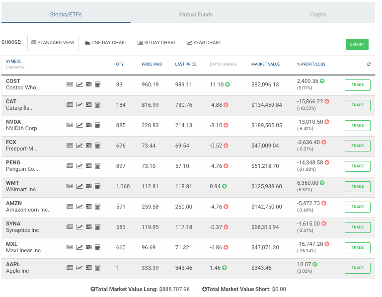
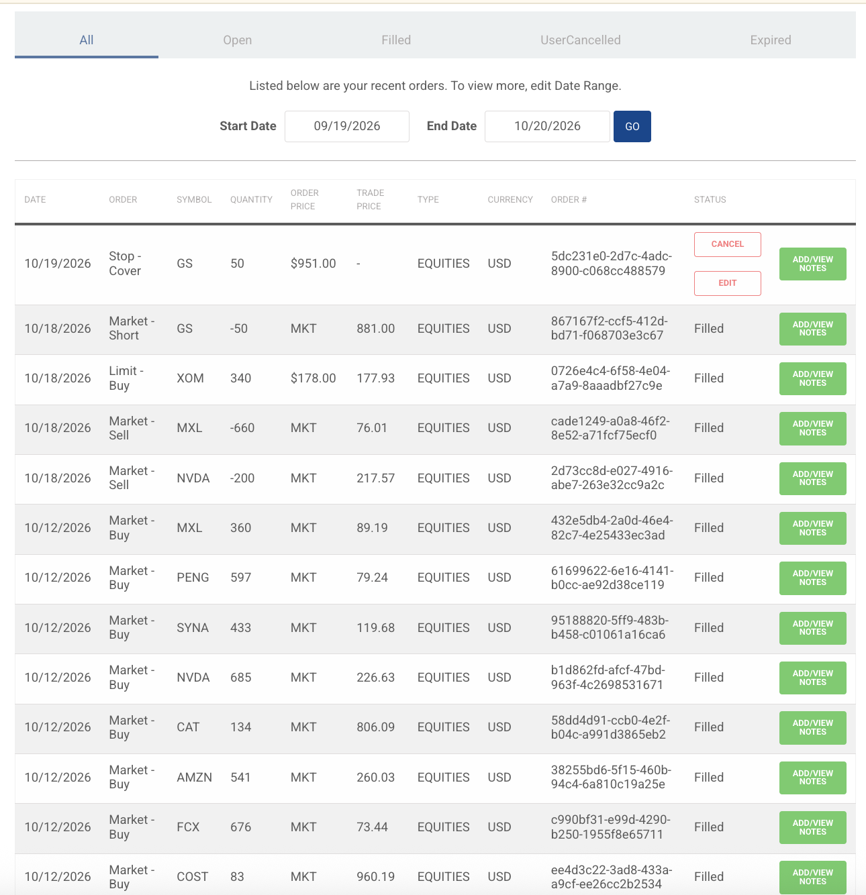
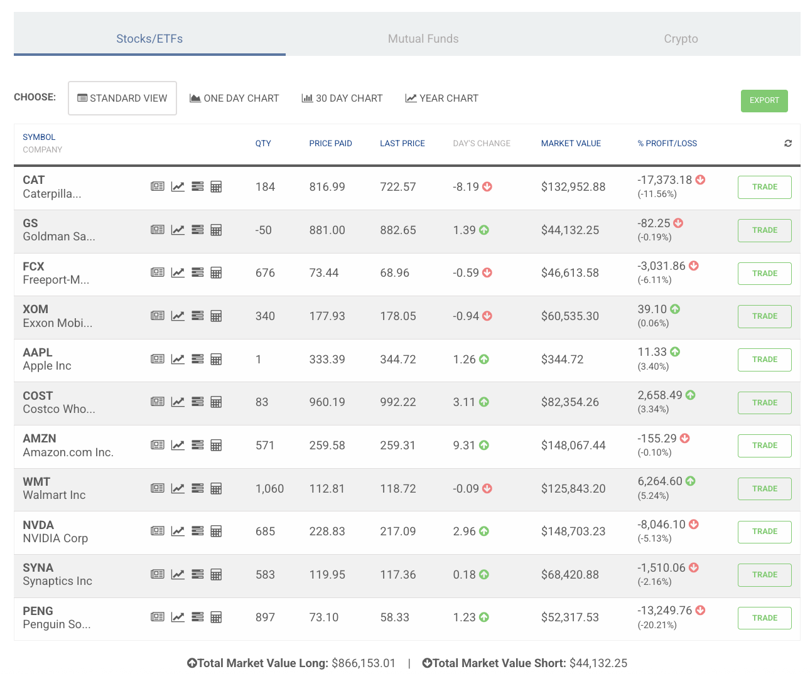

```{r setup, include=FALSE}
knitr::opts_chunk$set(echo = TRUE, message = FALSE, warning = FALSE)
```

### Liga de Github: 

# Parte 1. Modelos de regresión múltiple con cinco variables independientes

Para esta tarea, utilizamos la actividad 3 y Tarea 2 para seguir realizando modelos de regresión. En este caso, seguiremos utilizando los 3 modelos utilizados en la actividad 3: 

Modelo 102: Retail

Modelo 202: Tecnología

Modelo 302: Construcción y Maquinaria

Utilizando los mismos datos que habíamos obtenido en LSEG con intervalos de 5 y 30 mins entre el 8 y 9 de octubre del 2026. En este caso vamos a agregar 2 acciones adicionales a cada modelo, para cumplir con las 5 acciones que pide esta tarea. 

## Selección de modelos y justificación de variables

Los tres modelos parten de los de la Tarea 2 y conservan su variable dependiente y sus tres variables independientes originales. A cada modelo se le agregan dos variables: la primera es una emisora o un ETF que representa al sector o al mercado, y la segunda incorpora un factor que en los modelos anteriores no se medía de forma directa. Iniciamos con la selección de las emisoras adicionales por modelos: AMZN, SPY, NVDA, SOXX, XLI, FCX y AAPL y descargamos la información correspondientes y lo agregamos al excel que habíamos generado para la tarea pasada. 

### Modelo 102: sector consumo y retail

$$wmt\_r = \beta_0 + \beta_1\, cost\_r + \beta_2\, xlp\_r + \beta_3\, tgt\_r + \beta_4\, amzn\_r + \beta_5\, spy\_r + \varepsilon$$

La variable dependiente es el rendimiento de Walmart (WMT). Como en la Tarea 2, se incluyen Costco (COST), que compite con Walmart en el segmento de tiendas de mayoreo a través de Sam's Club; Target (TGT), su competidor directo en tiendas de autoservicio; y el ETF Consumer Staples Select Sector SPDR (XLP), que representa al sector de consumo básico. Las tres variables tienen signo esperado positivo. La primera variable nueva es Amazon (AMZN), el principal competidor de Walmart en comercio electrónico, con signo esperado positivo, ya que ambas responden a las condiciones de consumo de los hogares. La segunda variable nueva es el ETF SPDR S&P 500 (SPY), que representa al mercado en su conjunto y permite evaluar si Walmart responde al mercado además de a su sector, con signo esperado positivo. Como Walmart y Costco forman parte de XLP, se anticipa una correlación alta entre estas variables y un posible problema de multicolinealidad.

### Modelo 202: sector semiconductores

$$qcom\_r = \beta_0 + \beta_1\, peng\_r + \beta_2\, syna\_r + \beta_3\, mxl\_r + \beta_4\, nvda\_r + \beta_5\, soxx\_r + \varepsilon$$

La variable dependiente es el rendimiento de Qualcomm (QCOM). Como en la Tarea 2, se incluyen tres emisoras de semiconductores: Penguin Solutions (PENG), Synaptics (SYNA) y MaxLinear (MXL), todas con signo esperado positivo. La primera variable nueva es Nvidia (NVDA), la emisora de mayor tamaño del sector, que representa el ciclo de semiconductores asociado a la inteligencia artificial, con signo esperado positivo. La segunda variable nueva es el ETF iShares Semiconductor (SOXX), que representa al sector de semiconductores en su conjunto, con signo esperado positivo. Como Qualcomm y Nvidia forman parte de SOXX, se anticipa una correlación alta entre Nvidia y SOXX y un posible problema de multicolinealidad.

### Modelo 302: sector maquinaria y construcción

$$cat\_r = \beta_0 + \beta_1\, de\_r + \beta_2\, tex\_r + \beta_3\, osk\_r + \beta_4\, xli\_r + \beta_5\, fcx\_r + \varepsilon$$

La variable dependiente es el rendimiento de Caterpillar (CAT). Como en la Tarea 2, se incluyen tres fabricantes de maquinaria pesada: Deere (DE), Terex (TEX) y Oshkosh (OSK), todos con signo esperado positivo. La primera variable nueva es el ETF Industrial Select Sector SPDR (XLI), que representa al sector industrial, con signo esperado positivo. La segunda variable nueva es Freeport-McMoRan (FCX), productora de cobre. La minería es uno de los principales mercados de Caterpillar, por lo que se incluye para evaluar si su rendimiento responde a las condiciones de este sector, con signo esperado positivo. Como Caterpillar y Deere forman parte de XLI, se anticipa una correlación alta entre XLI y la variable dependiente.

## Carga y tratamiento de los datos

**Paso 1.** Instalación de paquetes: usamos los paquetes necesarios para tener lass librerías que require esta tarea

```{r, eval=FALSE}
install.packages("readxl")
install.packages("quantmod")
install.packages("car")
install.packages("lmtest")
install.packages("tseries")
install.packages("sandwich")
```

**Paso 2.** Carga de librerías: readxl para leer los archivos de Excel, quantmod para manejar series de tiempo y calcular rendimientos, car para el VIF, lmtest para las pruebas de heterocedasticidad y autocorrelación, tseries para la prueba de normalidad de Jarque-Bera y sandwich para los errores estándar de Newey-West.

```{r}
library(readxl)
library(quantmod)
library(car)
library(lmtest)
library(tseries)
library(sandwich)
```

**Paso 3.** Precios de cierre de 5 y de 30 minutos descargados de LSEG Workspace. Cada archivo contiene una columna con la fecha y hora (Timestamp) y una columna con el precio de cierre de cada una de las 19 emisoras.

```{r}
min5  <- read_excel("Tarea3_datos_5min.xlsx", sheet = "5min_valores")
min30 <- read_excel("Tarea3_datos_30min.xlsx", sheet = "30min_valores")
dim(min5)
dim(min30)
```

```{r}
head(min5[, 1:7])
```

```{r}
head(min30[, 1:7])
```

El archivo de 5 minutos contiene 109 filas y el de 30 minutos 19 filas, y ambos tienen 20 columnas: la fecha y hora (Timestamp) y el precio de cierre de las 19 emisoras. En los dos archivos, la primera barra corresponde al 8 de octubre de 2026 a las 13:30 (hora de Nueva York). En la frecuencia de 5 minutos, esta barra cubre el intervalo de 13:25 a 13:30, y algunas emisoras, como Target, Qualcomm y Penguin Solutions, no tienen precio en ella (NA), ya que la descarga de LSEG inició a partir de la barra siguiente. Esas filas incompletas se eliminan al construir la base de cada modelo. En la frecuencia de 30 minutos, la barra de las 13:30 cubre el intervalo de 13:00 a 13:30 y todas las emisoras tienen precio. Las filas del 8 de octubre llegan hasta el cierre de las 16:00, y la siguiente barra corresponde a la apertura del 9 de octubre (9:35 en 5 minutos y 10:00 en 30 minutos).

**Paso 4.** Conversión de los precios a series de tiempo (xts) ordenadas por fecha y hora, y conteo de los precios disponibles de cada emisora.

```{r}
p5  <- xts(as.data.frame(min5[, -1]), order.by = min5$Timestamp)
p30 <- xts(as.data.frame(min30[, -1]), order.by = min30$Timestamp)
colSums(!is.na(p5))
```

```{r}
colSums(!is.na(p30))
```

En la frecuencia de 5 minutos, el archivo tiene 109 barras posibles (31 del 8 de octubre y 78 del 9 de octubre), pero no todas las emisoras tienen precio en todas ellas. Walmart, Costco y las siete emisoras descargadas en la segunda descarga (Amazon, SPY, Nvidia, SOXX, XLI, Freeport-McMoRan y Apple) tienen las 109 barras completas. Target, Qualcomm, Penguin Solutions, Synaptics, MaxLinear, Caterpillar, Deere y Terex tienen 108, ya que no tienen precio en la primera barra del 8 de octubre (13:30). Oshkosh tiene 107, porque tampoco tiene precio en la barra de las 13:35. XLP tiene 105, ya que le faltan cuatro barras del 9 de octubre en las que no registró operaciones. Estos intervalos sin precio se eliminan al construir la base de cada modelo, por lo que cada modelo trabaja solo con los intervalos en los que sus seis emisoras tienen precio. En la frecuencia de 30 minutos, en cambio, las 19 emisoras tienen las 19 barras completas (6 del 8 de octubre y 13 del 9 de octubre), ya que en un intervalo más amplio siempre hubo al menos una operación.

**Paso 5.** Función para calcular los rendimientos de cada modelo. 

```{r}
rendimientos <- function(base) {
  r <- ROC(base, type = "discrete")
  dia <- as.Date(index(base))
  r <- r[c(FALSE, dia[-1] == dia[-length(dia)])]
  colnames(r) <- paste0(tolower(colnames(base)), "_r")
  as.data.frame(r)
}
```

## Modelo 102: Walmart (retail)

### Datos de 5 minutos

#### Construcción de la base y cálculo de rendimientos

Se seleccionan las seis emisoras del modelo y se conservan solo los intervalos en los que todas tienen precio. Después se calculan los rendimientos con la función del Paso 5.

```{r}
base102_5 <- na.omit(p5[, c("WMT", "COST", "XLP", "TGT", "AMZN", "SPY")])
nrow(base102_5)
```

```{r}
df102_5 <- rendimientos(base102_5)
nrow(df102_5)
```

```{r}
head(df102_5)
```

La base del modelo contiene 104 observaciones de 5 minutos. De las 109 barras del archivo se eliminaron cinco: la primera barra del 8 de octubre (13:30), en la que Target no tiene precio, y las cuatro barras del 9 de octubre en las que XLP no registró operaciones. Después de calcular los rendimientos y eliminar el primer rendimiento de cada una de las dos sesiones, quedan 102 rendimientos de 5 minutos. Por ello, el primer rendimiento de la base corresponde a la barra de las 13:40 del 8 de octubre, que mide el cambio de precio entre las 13:35 y las 13:40. Los rendimientos son del orden de centésimas de punto porcentual (por ejemplo, 0.15% para Walmart en la primera barra), lo que es consistente con la magnitud típica de los movimientos de precio en intervalos de 5 minutos.

#### Matriz de correlación

```{r}
round(cor(df102_5), 2)
```

Los rendimientos de Walmart tienen su correlación más alta con Costco (0.62), seguida de XLP (0.57) y de Target (0.37), por lo que, en intervalos de 5 minutos, Walmart se mueve principalmente con las emisoras de su propio sector. En cambio, su correlación con las dos variables nuevas es prácticamente nula y negativa: −0.04 con Amazon y −0.12 con el mercado (SPY). Esto indica que, en este periodo, Walmart no se movió con el mercado ni con su principal competidor en comercio electrónico, lo que es contrario al signo positivo esperado para ambas variables. Entre las variables explicativas, las correlaciones más altas son las de XLP con Costco (0.59) y con Target (0.49), lo que es consistente con que Walmart y Costco forman parte de XLP. Amazon y SPY tienen una correlación moderada entre sí (0.42), pero casi nula con las emisoras de consumo. Como ninguna correlación entre las variables explicativas supera 0.6, no se anticipa un problema grave de multicolinealidad, aunque XLP será la variable con el VIF más alto.

#### Regresión múltiple

```{r}
m102_5 <- lm(wmt_r ~ cost_r + xlp_r + tgt_r + amzn_r + spy_r, data = df102_5)
summary(m102_5)
```

**Residuales.** La mediana de los residuales es prácticamente cero (0.00002) y los cuartiles son aproximadamente simétricos (−0.00046 y 0.00038). Los valores extremos (−0.21% y 0.18%) tienen magnitudes parecidas, por lo que el modelo no sobreestima ni subestima de forma sistemática el rendimiento de Walmart.

**Significancia de los coeficientes.** Costco es la variable dominante del modelo (p-value < 0.001). Manteniendo constantes las demás variables, cuando el rendimiento de Costco aumenta un punto porcentual en un intervalo de 5 minutos, el de Walmart aumenta en promedio 0.48 puntos. XLP también es significativo al 5% (p-value = 0.023), con un coeficiente de 0.35, por lo que el sector de consumo básico aporta información adicional a la de Costco. Target solo es significativo al 10% (p-value = 0.082) y su efecto es menor (0.11). Las tres variables originales tienen el signo positivo esperado. En cuanto a las variables nuevas, ni Amazon (p-value = 0.45) ni SPY (p-value = 0.53) son significativas, y ambas tienen un coeficiente negativo (−0.05 y −0.13), contrario al signo positivo esperado, lo que es consistente con su correlación prácticamente nula con Walmart en este periodo. Esto indica que, una vez que se consideran las emisoras del sector, ni el comercio electrónico ni el mercado aportan información adicional sobre Walmart en intervalos de 5 minutos. El intercepto no es significativo (p-value = 0.58).

**Significancia del modelo.** El estadístico F (17.37, p-value < 0.001) indica que el modelo es significativo en su conjunto. Explica alrededor del 47% de la variación del rendimiento de Walmart (R cuadrada = 0.475; R cuadrada ajustada = 0.448). La diferencia entre ambas medidas refleja que dos de las cinco variables no aportan capacidad explicativa. El error estándar residual de 0.00066 indica que el modelo se equivoca típicamente en ±0.07% por intervalo de 5 minutos.

#### Intervalos de confianza

```{r}
confint(m102_5, level = 0.95)
```

Los intervalos de confianza al 95% de Costco (0.28, 0.68) y de XLP (0.05, 0.66) excluyen el cero, por lo que ambos efectos son positivos. El intervalo de Costco también excluye el uno, por lo que Walmart se mueve en una proporción menor que Costco. El intervalo de XLP es amplio y su límite inferior está cerca de cero, por lo que, aunque su efecto es positivo, su magnitud se estima con poca precisión. El intervalo de Target (−0.01, 0.23) incluye el cero por muy poco, lo que es consistente con que solo sea significativo al 10%. Los intervalos de Amazon (−0.17, 0.07), SPY (−0.53, 0.28) y el intercepto incluyen el cero, por lo que no puede descartarse que su efecto sea nulo. El intervalo de SPY es el más amplio del modelo, lo que confirma que el efecto del mercado sobre Walmart no puede estimarse con precisión en este periodo.


### Datos de 30 minutos

#### Construcción de la base y cálculo de rendimientos

Se sigue el mismo procedimiento que con los datos de 5 minutos.

```{r}
base102_30 <- na.omit(p30[, c("WMT", "COST", "XLP", "TGT", "AMZN", "SPY")])
nrow(base102_30)
```

```{r}
df102_30 <- rendimientos(base102_30)
nrow(df102_30)
```

```{r}
head(df102_30)
```

La base del modelo contiene 19 observaciones de 30 minutos, ya que las seis emisoras tienen precio en todas las barras del archivo y no se eliminó ningún intervalo. Después de eliminar el primer rendimiento de cada sesión, quedan 17 rendimientos: 5 del 8 de octubre (de las 14:00 a las 16:00) y 12 del 9 de octubre (de las 10:30 a las 16:00). En la tabla se observa que, después del rendimiento de las 16:00 del 8 de octubre, el siguiente corresponde a las 10:30 del 9 de octubre, lo que confirma que se eliminó el rendimiento de las 10:00, que medía el cambio entre el cierre del día anterior y la primera barra del día. Con 17 observaciones y seis parámetros por estimar, el modelo tiene solo 11 grados de libertad, por lo que sus resultados deben interpretarse con cautela. Los rendimientos de 30 minutos son de mayor magnitud que los de 5 minutos (por ejemplo, −0.46% y 0.42% para Walmart en las barras de las 14:30 y 15:00), lo que es consistente con que cada rendimiento acumula el movimiento de un intervalo seis veces más largo.

#### Matriz de correlación

```{r}
round(cor(df102_30), 2)
```
A 30 minutos, la correlación más alta de Walmart es con XLP (0.71), seguida de Costco (0.52) y de Target (0.37). A diferencia de los datos de 5 minutos, donde la relación más fuerte era con Costco (0.62), en este intervalo Walmart se mueve más con el sector en su conjunto que con su competidor más cercano. El cambio más notable está en las variables nuevas: la correlación de Walmart con el mercado (SPY) pasa de −0.12 a −0.59, y con Amazon de −0.04 a −0.22, por lo que, en intervalos de 30 minutos y en este periodo, Walmart tendió a moverse en sentido contrario al mercado. Lo mismo ocurre con Costco, XLP y Target, que también tienen correlaciones negativas con SPY y con Amazon (entre −0.25 y −0.45). Esto sugiere que, durante estas dos sesiones, los inversionistas se movieron entre las emisoras de consumo básico, consideradas defensivas, y el resto del mercado. Entre las variables explicativas, las correlaciones más

#### Regresión múltiple

```{r}
m102_30 <- lm(wmt_r ~ cost_r + xlp_r + tgt_r + amzn_r + spy_r, data = df102_30)
summary(m102_30)
```

**Residuales.** La mediana de los residuales es prácticamente cero (0.00003), pero los cuartiles no son simétricos: el tercer cuartil (0.0011) es aproximadamente el doble, en valor absoluto, que el primero (−0.00054). Además, el valor mínimo (−0.29%) es mayor en magnitud que el máximo (0.18%), lo que indica que hubo al menos un intervalo en el que Walmart bajó más de lo que el modelo estimaba. Con solo 17 observaciones, esta asimetría puede deberse a unos pocos intervalos.

**Significancia de los coeficientes.** A 30 minutos, XLP es la única variable significativa al 5% (p-value = 0.035). Manteniendo constantes las demás variables, cuando el rendimiento de XLP aumenta un punto porcentual en un intervalo de 30 minutos, el de Walmart aumenta en promedio 1.06 puntos, un efecto tres veces mayor que a 5 minutos (0.35). En cambio, Costco, que era la variable dominante a 5 minutos (0.48), deja de ser significativa (p-value = 0.68) y su coeficiente baja a 0.12. Target tampoco es significativa (p-value = 0.51). En cuanto a las variables nuevas, SPY es significativa solo al 10% (p-value = 0.089) y tiene un coeficiente negativo y de magnitud considerable (−1.40), contrario al signo positivo esperado, lo que es consistente con la correlación negativa de −0.59 entre Walmart y el mercado en este intervalo. Amazon no es significativa (p-value = 0.27), aunque su coeficiente cambia de signo y pasa a ser positivo (0.18). El intercepto no es significativo (p-value = 0.28). Los errores estándar de todos los coeficientes son entre dos y cuatro veces mayores que a 5 minutos, lo que refleja la menor precisión de las estimaciones con 17 observaciones.

**Significancia del modelo.** El estadístico F (4.43, p-value = 0.019) indica que el modelo es significativo en su conjunto al 5%, aunque con mucha menos fuerza que el de 5 minutos (p-value < 0.001). La R cuadrada (0.668) es mayor que a 5 minutos (0.475), pero la R cuadrada ajustada (0.518) es considerablemente menor que la R cuadrada. La diferencia de 15 puntos entre ambas medidas refleja la penalización por estimar seis parámetros con solo 11 grados de libertad, por lo que el mayor ajuste a 30 minutos debe tomarse con cautela. El error estándar residual de 0.0016 indica que el modelo se equivoca típicamente en ±0.16% por intervalo de 30 minutos, más del doble que a 5 minutos (±0.07%), lo que es consistente con la mayor magnitud de los rendimientos en un intervalo más largo.

#### Intervalos de confianza

```{r}
confint(m102_30, level = 0.95)
```
A 30 minutos, el único intervalo de confianza al 95% que excluye el cero es el de XLP (0.09, 2.04), lo que confirma su efecto positivo sobre Walmart. Sin embargo, el intervalo es muy amplio e incluye tanto el uno como el coeficiente estimado a 5 minutos (0.35), por lo que no puede concluirse que el efecto del sector sea distinto entre ambas frecuencias. Los intervalos de Costco (−0.52, 0.76), Target (−0.20, 0.38), Amazon (−0.16, 0.53), SPY (−3.05, 0.25) y el intercepto incluyen el cero, por lo que no puede descartarse que su efecto sea nulo. El intervalo de Costco también incluye su coeficiente de 5 minutos (0.48), por lo que la pérdida de significancia a 30 minutos se explica principalmente por la menor precisión de la estimación y no necesariamente por un cambio en la relación entre ambas emisoras. En general, los intervalos son mucho más amplios que a 5 minutos, lo que confirma que, con 17 observaciones, los coeficientes del modelo de 30 minutos se estiman con poca precisión.

## Modelo 202: Qualcomm (semiconductores)

### Datos de 5 minutos

#### Construcción de la base y cálculo de rendimientos

Se sigue el mismo procedimiento que en el Modelo 102.

```{r}
base202_5 <- na.omit(p5[, c("QCOM", "PENG", "SYNA", "MXL", "NVDA", "SOXX")])
nrow(base202_5)
```

```{r}
df202_5 <- rendimientos(base202_5)
nrow(df202_5)
```

```{r}
head(df202_5)
```

La base del modelo contiene 108 observaciones de 5 minutos. De las 109 barras del archivo solo se eliminó la primera barra del 8 de octubre (13:30), en la que Qualcomm, Penguin Solutions, Synaptics y MaxLinear no tienen precio. Después de eliminar el primer rendimiento de cada sesión, quedan 106 rendimientos de 5 minutos, por lo que este modelo tiene cuatro observaciones más que el Modelo 102, en el que XLP no registró operaciones en algunos intervalos. Al igual que en el Modelo 102, el primer rendimiento corresponde a la barra de las 13:40 del 8 de octubre. En la tabla se observa que las emisoras de menor tamaño tienen movimientos más amplios que Qualcomm, Nvidia y SOXX. Por ejemplo, en la barra de las 13:55, Penguin Solutions subió 1.39% y MaxLinear 1.18%, mientras que Qualcomm subió 0.18%. Esto anticipa que una parte importante de los movimientos de estas emisoras no se relaciona con los de Qualcomm.

#### Matriz de correlación

```{r}
round(cor(df202_5), 2)
```
Los rendimientos de Qualcomm tienen correlaciones moderadas o bajas con todas las variables del modelo. La más alta es con el ETF del sector, SOXX (0.46), seguida de MaxLinear (0.34), Penguin Solutions (0.31), Synaptics (0.24) y Nvidia (0.21). Son correlaciones menores que las del Modelo 102, en el que Walmart tenía correlaciones de 0.57 y 0.62 con XLP y Costco, por lo que se anticipa que este modelo explique una proporción menor de la variación de su variable dependiente. Llama la atención que Nvidia, la nueva variable que representa el ciclo de semiconductores, sea la emisora con la correlación más baja con Qualcomm, por lo que, en intervalos de 5 minutos, ambas

#### Regresión múltiple

```{r}
m202_5 <- lm(qcom_r ~ peng_r + syna_r + mxl_r + nvda_r + soxx_r, data = df202_5)
summary(m202_5)
```

**Residuales.** La mediana de los residuales es prácticamente cero (−0.00006) y los cuartiles son aproximadamente simétricos (−0.0011 y 0.00086). El valor máximo (0.49%) es algo mayor en magnitud que el mínimo (−0.38%), lo que indica que hubo intervalos en los que Qualcomm subió más de lo que el modelo estimaba. Los residuales son mayores que los del Modelo 102, lo que refleja que una parte más grande del rendimiento de Qualcomm no se explica por las variables del modelo.

**Significancia de los coeficientes.** SOXX es la única variable explicativa significativa (p-value = 0.005). Manteniendo constantes las demás variables, cuando el rendimiento de SOXX aumenta un punto porcentual en un intervalo de 5 minutos, el de Qualcomm aumenta en promedio 0.42 puntos. Las tres variables originales no son significativas: Penguin Solutions (p-value = 0.46), Synaptics (p-value = 0.71) y MaxLinear (p-value = 0.99), cuyo coeficiente es prácticamente cero. Esto indica que, una vez que se considera el movimiento del sector a través de SOXX, las emisoras individuales no aportan información adicional sobre Qualcomm, ya que su relación con ella se debía principalmente al factor común del sector. La otra variable nueva, Nvidia, tampoco es significativa (p-value = 0.77) y su coeficiente es negativo (−0.05), contrario al signo positivo esperado, lo que es consistente con su baja correlación con Qualcomm. A diferencia del Modelo 102, el intercepto es significativo al 5% (p-value = 0.038), lo que indica que en este periodo Qualcomm tuvo un rendimiento promedio positivo de alrededor de 0.03% por intervalo de 5 minutos que no se explica por las variables del modelo.

**Significancia del modelo.** El estadístico F (5.66, p-value < 0.001) indica que el modelo es significativo en su conjunto. Sin embargo, explica solo alrededor del 22% de la variación del rendimiento de Qualcomm (R cuadrada = 0.221; R cuadrada ajustada = 0.182), menos de la mitad que el Modelo 102 a 5 minutos (0.475). Por lo tanto, la mayor parte del rendimiento de Qualcomm en este periodo depende de factores propios de la empresa. El error estándar residual de 0.00168 indica que el modelo se equivoca típicamente en ±0.17% por intervalo de 5 minutos, más del doble que el Modelo 102 (±0.07%).

#### Intervalos de confianza

```{r}
confint(m202_5, level = 0.95)
```
El intervalo de confianza al 95% de SOXX (0.13, 0.71) excluye el cero, lo que confirma su efecto positivo sobre Qualcomm. También excluye el uno, por lo que Qualcomm se mueve en una proporción menor que el sector. Los intervalos de Penguin Solutions (−0.04, 0.10), Synaptics (−0.38, 0.55), MaxLinear (−0.08, 0.08) y Nvidia (−0.42, 0.31) incluyen el cero, por lo que no puede descartarse que su efecto sea nulo. Los intervalos de Synaptics y Nvidia son los más amplios del modelo, por lo que su efecto sobre Qualcomm se estima con poca precisión. El intervalo del intercepto (0.00002, 0.00068) es completamente positivo, aunque su límite inferior está muy cerca de cero, lo que confirma que el


### Datos de 30 minutos

#### Construcción de la base y cálculo de rendimientos

```{r}
base202_30 <- na.omit(p30[, c("QCOM", "PENG", "SYNA", "MXL", "NVDA", "SOXX")])
nrow(base202_30)
```

```{r}
df202_30 <- rendimientos(base202_30)
nrow(df202_30)
```

```{r}
head(df202_30)
```

La base del modelo contiene 19 observaciones de 30 minutos, ya que las seis emisoras tienen precio en todas las barras del archivo. Después de eliminar el primer rendimiento de cada sesión, quedan 17 rendimientos (5 del 8 de octubre y 12 del 9 de octubre), igual que en el Modelo 102 a 30 minutos, por lo que el modelo tiene solo 11 grados de libertad. En la tabla se observa que Qualcomm tuvo rendimientos positivos en los seis primeros intervalos, de entre 0.06% y 0.76%. Al igual que a 5 minutos, Penguin Solutions y MaxLinear tienen los movimientos más amplios, con rendimientos de hasta 1.6% y 1.7% en valor absoluto por intervalo, mientras que los de Synaptics son mucho menores, de alrededor de 0.2% o menos.

#### Matriz de correlación

```{r}
round(cor(df202_30), 2)
```

A 30 minutos, las correlaciones de Qualcomm con el sector son más altas que a 5 minutos. Su correlación con SOXX pasa de 0.46 a 0.64 y con Nvidia de 0.21 a 0.50, por lo que, en un intervalo más amplio, Qualcomm se mueve más de cerca con el sector y con la emisora más grande de semiconductores. Este aumento es consistente con el efecto Epps, según el cual las correlaciones entre activos tienden a ser menores en intervalos muy cortos. En cambio, las correlaciones con las emisoras originales son bajas: 0.21 con Synaptics y con MaxLinear, y prácticamente nula con Penguin Solutions (0.08). Entre las variables explicativas, destaca la correlación de Nvidia con SOXX (0.82), mucho mayor que a 5 minutos (0.54) y la más alta del modelo, por lo que se anticipa un problema de multicolinealidad entre ambas variables. Esto es consistente con que Nvidia sea una de las emisoras con mayor peso en SOXX. También destaca que la correlación entre Synaptics y MaxLinear cambia de signo, de 0.49 a −0.30, lo que, con solo 17 observaciones, puede deberse a unos pocos intervalos.

#### Regresión múltiple

```{r}
m202_30 <- lm(qcom_r ~ peng_r + syna_r + mxl_r + nvda_r + soxx_r, data = df202_30)
summary(m202_30)
```

**Residuales.** La mediana de los residuales es prácticamente cero (−0.0001), pero los cuartiles no son simétricos (−0.0019 y 0.0011). El valor máximo (0.63%) es mayor en magnitud que el mínimo (−0.44%), lo que indica que hubo intervalos en los que Qualcomm subió más de lo que el modelo estimaba. Los residuales son aproximadamente el doble de grandes que a 5 minutos, lo que refleja tanto la mayor magnitud de los rendimientos de 30 minutos como el bajo ajuste del modelo.

**Significancia de los coeficientes.** A 30 minutos, ninguna de las cinco variables explicativas es significativa. SOXX, que era la única variable significativa a 5 minutos, deja de serlo (p-value = 0.13), aunque su coeficiente aumenta de 0.42 a 0.86 y conserva el signo positivo esperado. Nvidia tampoco es significativa (p-value = 0.67) y su coeficiente sigue siendo negativo (−0.32), contrario al signo esperado, a pesar de que su correlación simple con Qualcomm es positiva (0.50). Este cambio de signo, junto con los errores estándar elevados de Nvidia (0.72) y SOXX (0.53), es consistente con la alta correlación entre ambas variables (0.82): como se mueven casi juntas, el modelo no puede separar el efecto de cada una. Las tres variables originales tampoco son significativas: Penguin Solutions (p-value = 0.61), Synaptics (p-value = 0.99) y MaxLinear (p-value = 0.98), con coeficientes prácticamente nulos. El único coeficiente significativo al 5% es el intercepto (p-value = 0.049), que indica que en este periodo Qualcomm tuvo un rendimiento promedio de alrededor de 0.20% por intervalo de 30 minutos que no se explica por las variables del modelo. Este valor es consistente con el intercepto del modelo de 5 minutos (0.035% por intervalo), ya que un intervalo de 30 minutos acumula seis de 5 minutos (6 × 0.035% ≈ 0.21%).

**Significancia del modelo.** El estadístico F (1.66, p-value = 0.23) no permite rechazar la hipótesis nula de que todos los coeficientes de las variables explicativas son iguales a cero, por lo que, a diferencia del modelo de 5 minutos, el modelo de 30 minutos no es significativo en su conjunto. La R cuadrada (0.430) es mayor que a 5 minutos (0.221), pero la R cuadrada ajustada cae a 0.170, una diferencia de 26 puntos que refleja la fuerte penalización por estimar seis parámetros con solo 11 grados de libertad. El error estándar residual de 0.0034 indica que el modelo se equivoca típicamente en ±0.34% por intervalo de 30 minutos. En conjunto, con 17 observaciones y una alta correlación entre Nvidia y SOXX, el modelo de 30 minutos no permite obtener conclusiones confiables sobre la relación de Qualcomm con el sector, por lo que se corrige en la Parte 2.

#### Intervalos de confianza

```{r}
confint(m202_30, level = 0.95)
```

A 30 minutos, todos los intervalos de confianza al 95% de las variables explicativas incluyen el cero, por lo que no puede descartarse que el efecto de ninguna de ellas sea nulo. Los intervalos son muy amplios, en especial los de Synaptics (−2.21, 2.24), Nvidia (−1.90, 1.27) y SOXX (−0.31, 2.04), que abarcan tanto efectos negativos como positivos de gran magnitud, por lo que el modelo no permite determinar ni siquiera el signo de estos efectos. El intervalo de SOXX incluye su coeficiente de 5 minutos (0.42), por lo que la pérdida de significancia a 30 minutos se explica por la menor precisión de la estimación y no necesariamente por un cambio en la relación entre Qualcomm y el sector. Los intervalos de Penguin Solutions (−0.34, 0.21) y MaxLinear (−0.22, 0.22) son más estrechos, pero están prácticamente centrados en cero. El único intervalo que excluye el cero es el del intercepto (0.00001, 0.0040), aunque su límite inferior está muy cerca de cero, lo que confirma que el rendimiento propio de Qualcomm en el periodo fue positivo, pero que su magnitud se estima con poca precisión.

## Modelo 302: Caterpillar (maquinaria y construcción)

### Datos de 5 minutos

#### Construcción de la base y cálculo de rendimientos

Se sigue el mismo procedimiento que en los modelos anteriores.

```{r}
base302_5 <- na.omit(p5[, c("CAT", "DE", "TEX", "OSK", "XLI", "FCX")])
nrow(base302_5)
```

```{r}
df302_5 <- rendimientos(base302_5)
nrow(df302_5)
```

```{r}
head(df302_5)
```

La base del modelo contiene 107 observaciones de 5 minutos. De las 109 barras del archivo se eliminaron las dos primeras del 8 de octubre: la de las 13:30, en la que Caterpillar, Deere, Terex y Oshkosh no tienen precio, y la de las 13:35, en la que Oshkosh tampoco tiene precio. Después de eliminar el primer rendimiento de cada sesión, quedan 105 rendimientos de 5 minutos. Por ello, a diferencia de los Modelos 102 y 202, el primer rendimiento de la base corresponde a la barra de las 13:45 del 8 de octubre. En la tabla se observa que los rendimientos de Caterpillar y XLI suelen tener el mismo signo y una magnitud parecida, por ejemplo, 0.20% y 0.22% en la barra de las 13:45, lo que anticipa una relación cercana entre Caterpillar y el sector industrial.

#### Matriz de correlación

```{r}
round(cor(df302_5), 2)
```
Los rendimientos de Caterpillar tienen su correlación más alta con XLI (0.76), la más alta entre una variable dependiente y una explicativa en los tres modelos a 5 minutos, lo que confirma que Caterpillar se mueve de cerca con el sector industrial. Le siguen Terex (0.46) y Freeport-McMoRan (0.33), mientras que con Deere (0.21) y Oshkosh (0.22) la correlación es baja. Así, la nueva variable de minería (FCX) se relaciona más con Caterpillar que dos de los tres fabricantes de maquinaria originales, lo que es consistente con la importancia de la minería como mercado de Caterpillar. Entre las variables explicativas, las correlaciones más altas son las de Terex con Oshkosh (0.59) y con XLI (0.51), y la de XLI con Deere (0.42). Como ninguna supera 0.6, no se anticipa un problema grave de multicolinealidad, aunque XLI es la variable que más información comparte con las demás, lo que es consistente con que represente al sector en su conjunto. Freeport-McMoRan tiene correlaciones bajas con las demás variables (entre 0.14 y 0.37), por lo que aporta información distinta a la del sector industrial.

#### Regresión múltiple

```{r}
m302_5 <- lm(cat_r ~ de_r + tex_r + osk_r + xli_r + fcx_r, data = df302_5)
summary(m302_5)
```

**Residuales.** La mediana de los residuales es prácticamente cero (0.000003) y los cuartiles son simétricos (−0.00073 y 0.00070). El valor mínimo (−0.35%) es algo mayor en magnitud que el máximo (0.26%), lo que indica que hubo al menos un intervalo en el que Caterpillar bajó más de lo que el modelo estimaba, aunque en general el modelo no sobreestima ni subestima de forma sistemática su rendimiento.

**Significancia de los coeficientes.** XLI es la variable dominante del modelo (p-value < 0.001). Manteniendo constantes las demás variables, cuando el rendimiento de XLI aumenta un punto porcentual en un intervalo de 5 minutos, el de Caterpillar aumenta en promedio 1.60 puntos, por lo que Caterpillar amplifica los movimientos del sector industrial. Parte de esta relación puede ser mecánica, ya que Caterpillar forma parte de XLI. Terex también es significativa al 5% (p-value = 0.040) y tiene el signo positivo esperado, con un coeficiente de 0.12. Deere es significativa al 5% (p-value = 0.047), pero su coeficiente es negativo (−0.07), contrario al signo positivo esperado y a su correlación simple positiva con Caterpillar (0.21). Esto no indica que ambas emisoras se muevan en sentidos opuestos, sino que, para un mismo movimiento del sector, cuando Deere sube más que XLI, Caterpillar tiende a quedarse atrás. Oshkosh no es significativa (p-value = 0.16) y su coeficiente también es negativo (−0.12). La nueva variable de minería, Freeport-McMoRan, no es significativa (p-value = 0.44), a pesar de su correlación de 0.33 con Caterpillar, por lo que su relación con Caterpillar parece explicarse por su relación con el sector industrial. El intercepto no es significativo (p-value = 0.25).

**Significancia del modelo.** El estadístico F (31.09, p-value < 0.001) indica que el modelo es significativo en su conjunto. Explica alrededor del 61% de la variación del rendimiento de Caterpillar (R cuadrada = 0.611; R cuadrada ajustada = 0.591), el mayor ajuste de los tres modelos a 5 minutos, por arriba del Modelo 102 (0.475) y del Modelo 202 (0.221). El error estándar residual de 0.00102 indica que el modelo se equivoca típicamente en ±0.10% por intervalo de 5 minutos.

#### Intervalos de confianza

```{r}
confint(m302_5, level = 0.95)
```
El intervalo de confianza al 95% de XLI (1.26, 1.94) excluye tanto el cero como el uno, lo que confirma que Caterpillar amplifica los movimientos del sector industrial, con una sensibilidad mayor a uno. Los intervalos de Terex (0.006, 0.24) y de Deere (−0.14, −0.001) también excluyen el cero, pero sus límites están muy cerca de él, por lo que, aunque sus efectos son estadísticamente significativos, su magnitud es reducida y se estima con poca precisión. En términos de Gujarati, son coeficientes estadísticamente significativos con poca relevancia práctica. Los intervalos de Oshkosh (−0.29, 0.05), Freeport-McMoRan (−0.07, 0.16) y el intercepto incluyen el cero, por lo que no puede descartarse que su efecto sea nulo.

### Datos de 30 minutos

#### Construcción de la base y cálculo de rendimientos

```{r}
base302_30 <- na.omit(p30[, c("CAT", "DE", "TEX", "OSK", "XLI", "FCX")])
nrow(base302_30)
```

```{r}
df302_30 <- rendimientos(base302_30)
nrow(df302_30)
```

```{r}
head(df302_30)
```

La base del modelo contiene 19 observaciones de 30 minutos, ya que, a diferencia de los datos de 5 minutos, las seis emisoras tienen precio en todas las barras del archivo, incluida la primera del 8 de octubre. Después de eliminar el primer rendimiento de cada sesión, quedan 17 rendimientos (5 del 8 de octubre y 12 del 9 de octubre), igual que en los Modelos 102 y 202 a 30 minutos, por lo que el modelo tiene solo 11 grados de libertad. En la tabla se observa que la relación entre Caterpillar y XLI es menos estable que a 5 minutos. Por ejemplo, en la barra de las 15:00 del 8 de octubre Caterpillar bajó 0.69%, mientras que XLI bajó solo 0.07%, y en la barra de las 10:30 del 9 de octubre Caterpillar subió 0.04%, mientras que Terex, Freeport-McMoRan, Deere y Oshkosh bajaron entre 0.60% y 1.07%.

#### Matriz de correlación

```{r}
round(cor(df302_30), 2)
```
A 30 minutos, la correlación más alta de Caterpillar sigue siendo con XLI (0.73), prácticamente igual que a 5 minutos (0.76), por lo que la relación de Caterpillar con el sector industrial es estable entre ambas frecuencias. Sus correlaciones con Deere (0.31), Terex (0.30), Freeport-McMoRan (0.29) y Oshkosh (0.18) son bajas, con cambios menores respecto a 5 minutos: aumenta ligeramente la de Deere (de 0.21 a 0.31) y disminuye la de Terex (de 0.46 a 0.30). El cambio más importante está entre las variables explicativas, cuyas correlaciones aumentan de forma generalizada. La correlación de Terex con Oshkosh pasa de 0.59 a 0.76, la de Oshkosh con Freeport-McMoRan de 0.20 a 0.61, y Deere tiene correlaciones de entre 0.51 y 0.56 con Terex, Oshkosh y XLI. Así, a 30 minutos, las emisoras de maquinaria y de minería se mueven más de cerca entre sí que con Caterpillar, lo que es consistente con el efecto Epps observado en el Modelo 202. Por la correlación de 0.76 entre Terex y Oshkosh, y por el aumento general de las correlaciones entre las variables explicativas, se anticipa multicolinealidad moderada en este modelo, que se evalúa con el VIF en la Parte 2.

#### Regresión múltiple

```{r}
m302_30 <- lm(cat_r ~ de_r + tex_r + osk_r + xli_r + fcx_r, data = df302_30)
summary(m302_30)
```

**Residuales.** La mediana de los residuales es prácticamente cero (0.0001), pero los cuartiles no son simétricos (−0.00072 y 0.0012). El valor mínimo (−0.51%) es casi el doble, en valor absoluto, que el máximo (0.28%), lo que indica que hubo al menos un intervalo en el que Caterpillar bajó mucho más de lo que el modelo estimaba, posiblemente la barra de las 15:00 del 8 de octubre, en la que Caterpillar bajó 0.69% mientras que XLI bajó solo 0.07%.

**Significancia de los coeficientes.** A 30 minutos, XLI sigue siendo la variable dominante y la única significativa al 5% (p-value = 0.010). Manteniendo constantes las demás variables, cuando el rendimiento de XLI aumenta un punto porcentual en un intervalo de 30 minutos, el de Caterpillar aumenta en promedio 1.70 puntos, una sensibilidad muy parecida a la de 5 minutos (1.60), por lo que la relación de Caterpillar con el sector industrial se mantiene entre ambas frecuencias. En cambio, Deere y Terex, que eran significativas al 5% a 5 minutos, dejan de serlo (p-values de 0.76 y 0.83), aunque conservan el mismo signo (−0.03 y 0.05). Oshkosh sigue sin ser significativa (p-value = 0.51) y su coeficiente sigue siendo negativo (−0.20), y Freeport-McMoRan tampoco es significativa (p-value = 0.98), con un coeficiente prácticamente nulo. El intercepto no es significativo (p-value = 0.46). Los errores estándar de todas las variables son entre tres y cuatro veces mayores que a 5 minutos, lo que refleja la menor precisión de las estimaciones con 17 observaciones y la mayor correlación entre las variables explicativas.

**Significancia del modelo.** El estadístico F (2.88, p-value = 0.067) indica que el modelo solo es significativo en su conjunto al 10%, pero no al 5%, a diferencia del modelo de 5 minutos (p-value < 0.001). La R cuadrada (0.567) es ligeramente menor que a 5 minutos (0.611), pero la R cuadrada ajustada cae a 0.371, una diferencia de 20 puntos que refleja la penalización por estimar seis parámetros con solo 11 grados de libertad. El error estándar residual de 0.0023 indica que el modelo se equivoca típicamente en ±0.23% por intervalo de 30 minutos.

#### Intervalos de confianza

```{r}
confint(m302_30, level = 0.95)
```

A 30 minutos, el único intervalo de confianza al 95% que excluye el cero es el de XLI (0.49, 2.91), lo que confirma el efecto positivo del sector industrial sobre Caterpillar. Sin embargo, a diferencia de 5 minutos, el intervalo incluye el uno, por lo que con 17 observaciones no puede concluirse que Caterpillar amplifique los movimientos del sector. El intervalo también incluye el coeficiente de 5 minutos (1.60), lo que confirma que la sensibilidad de Caterpillar a XLI es estadísticamente similar en ambas frecuencias. Los intervalos de Deere (−0.22, 0.17), Terex (−0.44, 0.54), Oshkosh (−0.85, 0.45), Freeport-McMoRan (−0.54, 0.56) y el intercepto incluyen el cero, por lo que no puede descartarse que su efecto sea nulo. Los intervalos de Deere y Terex incluyen sus coeficientes de 5 minutos, por lo que su pérdida de significancia se explica por la menor precisión de la estimación.

## Conclusiones de la Parte 1. 

Los tres modelos a 5 minutos son significativos en su conjunto al 1%, y su ajuste es muy distinto entre sectores. El modelo de maquinaria y construcción es el que mejor explica a su variable dependiente (R cuadrada de 0.611), seguido del de retail (0.475) y del de semiconductores (0.221). En cada modelo, una sola variable concentra la mayor parte de la capacidad explicativa: Costco en el caso de Walmart, SOXX en el caso de Qualcomm y XLI en el caso de Caterpillar. En los modelos de Qualcomm y Caterpillar, la variable dominante es el ETF del sector, lo que indica que estas emisoras responden principalmente al factor común de su industria, más que a los movimientos de sus competidores individuales.

Los modelos de 30 minutos tienen R cuadradas similares o mayores (0.668, 0.430 y 0.567), pero sus R cuadradas ajustadas son mucho menores (0.518, 0.170 y 0.371), y solo el modelo de retail es significativo al 5%. El de construcción solo lo es al 10% y el de semiconductores no es significativo. Con 17 observaciones y 11 grados de libertad, los errores estándar son entre dos y cuatro veces mayores que a 5 minutos, por lo que la mayoría de las variables pierden significancia. Sin embargo, en casi todos los casos los intervalos de confianza de 30 minutos incluyen los coeficientes de 5 minutos, por lo que las diferencias entre frecuencias se explican principalmente por la menor precisión de las estimaciones. La relación más estable entre frecuencias es la de Caterpillar con XLI, con una sensibilidad de 1.60 a 5 minutos y de 1.70 a 30 minutos.

Las variables nuevas tuvieron resultados distintos. SOXX y XLI, que representan a su sector, fueron las variables dominantes de sus modelos. En cambio, Amazon y Nvidia no fueron significativas en ninguna frecuencia, y Freeport-McMoRan tampoco, a pesar de su correlación positiva con Caterpillar. El mercado (SPY) no fue significativo a 5 minutos y, a 30 minutos, tuvo un coeficiente negativo significativo al 10% en el modelo de Walmart, consistente con su correlación de −0.59 con el mercado en ese intervalo.

Estos resultados tienen implicaciones para el portafolio. En este periodo, Walmart y las emisoras de consumo básico tuvieron una relación negativa con el mercado a 30 minutos, por lo que funcionaron como diversificadoras frente a las posiciones más expuestas al ciclo económico. Caterpillar se mueve de cerca con el sector industrial y amplifica sus movimientos a 5 minutos, por lo que su riesgo depende principalmente del desempeño de ese sector. Qualcomm, en cambio, tiene la mayor parte de su rendimiento explicado por factores propios de la empresa, por lo que es la emisora con mayor riesgo específico de los tres modelos. Estas conclusiones se retoman en la estrategia de la Parte 4, una vez evaluados los supuestos de cada modelo en la Parte 2.


# Parte 2. Detección de violación de supuestos y corrección

En esta parte se evalúa si los modelos de la Parte 1 cumplen. En todas las pruebas utilizadas, la hipótesis nula corresponde al cumplimiento del supuesto, por lo que rechazarla implica detectar su violación. La multicolinealidad se evalúa con el factor de inflación de la varianza (VIF), con un umbral de 5; la heterocedasticidad, con las pruebas de Breusch-Pagan y Goldfeld-Quandt; la autocorrelación, con las pruebas de Durbin-Watson y Breusch-Godfrey; y la normalidad de los residuos, con su histograma y la prueba de Jarque-Bera. La prueba de Breusch-Godfrey se aplica con 5 rezagos en los modelos de 5 minutos y con 2 rezagos en los de 30 minutos, ya que con menos de 20 observaciones no es posible incluir más rezagos sin perder casi todos los grados de libertad.

Cuando se detecta un problema, se aplica una corrección. La multicolinealidad se corrige eliminando la variable que la concentra (vif >5) . La heterocedasticidad y la autocorrelación no sesgan los coeficientes, pero sí sus errores estándar, por lo que se corrigen con los errores estándar de Newey-West, que de acuerdo con Gujarati (capítulo 12) son consistentes con ambos problemas.

## Modelo 102

### Datos de 5 minutos

#### Multicolinealidad (VIF)

```{r}
vif(m102_5)
```

Los VIF de las cinco variables son bajos, entre 1.26 y 1.92, todos por debajo del umbral de 5, por lo que el modelo no presenta multicolinealidad y no requiere corrección. El valor más alto corresponde a XLP (1.92), lo que es consistente con su correlación con Costco (0.59) y con Target (0.49), y con que Walmart y Costco formen parte de este ETF. Aun así, su VIF implica que el error estándar de su coeficiente es solo alrededor de 1.4 veces mayor al que tendría sin multicolinealidad. Le siguen Costco (1.54) y Target (1.35), mientras que las dos variables nuevas, Amazon (1.26) y SPY (1.26), son las que menos información comparten con las demás, lo que confirma que aportan información distinta a la de las emisoras del sector de consumo.

#### Heterocedasticidad

```{r}
bptest(m102_5)
```

```{r}
gqtest(m102_5)
```

El test de Breusch-Pagan (BP = 13.54, p-value = 0.019) rechaza al 5% la hipótesis nula de homocedasticidad, por lo que la varianza de los errores se relaciona con los valores de las variables explicativas. El contraste de Goldfeld-Quandt (GQ = 1.00, p-value = 0.51) no la rechaza, y su estadístico, prácticamente igual a uno, indica que la varianza de los residuales es la misma en la primera y en la segunda mitad del periodo. En conjunto, la heterocedasticidad no se presenta a lo largo del tiempo, sino en relación con la magnitud de los movimientos de las variables explicativas: en los intervalos en los que las emisoras del sector o el mercado tienen movimientos más amplios, los errores del modelo también tienden a ser mayores. Esto no sesga los coeficientes, pero sí resta confiabilidad a sus errores estándar y p-values, por lo que se corrige más adelante con los errores estándar de Newey-West.

#### Autocorrelación

```{r}
dwtest(m102_5)
```

```{r}
dwtest(m102_5, alternative = "two.sided")
```

```{r}
bgtest(m102_5, order = 5)
```

La prueba de Durbin-Watson arroja un estadístico de 2.26, ligeramente por encima de 2, lo que corresponde a una autocorrelación de primer orden ligeramente negativa (ρ ≈ 1 − d/2 ≈ −0.13). La prueba de una cola, que solo evalúa autocorrelación positiva, no rechaza la hipótesis nula (p-value = 0.91), y la de dos colas, que también considera la autocorrelación negativa, tampoco la rechaza (p-value = 0.19). La prueba de Breusch-Godfrey de orden 5 (LM = 7.08, p-value = 0.22) tampoco rechaza la hipótesis nula, por lo que no hay evidencia de autocorrelación en los primeros cinco rezagos, es decir, en los 25 minutos anteriores. El modelo no presenta autocorrelación.

#### Normalidad de los residuos

```{r}
hist(residuals(m102_5), breaks = 30, main = "Residuos del Modelo 102 (5 minutos)", xlab = "Residuos", col = "grey")
```

```{r}
jarque.bera.test(residuals(m102_5))
```

El histograma muestra residuos centrados en cero, con la mayor parte de las observaciones entre −0.08% y 0.12%. Su forma no es exactamente la de una campana, ya que es relativamente plana en el centro y tiene algunos valores aislados en ambas colas, en especial dos residuales cercanos a −0.2% y uno cercano a 0.19%. Sin embargo, la prueba de Jarque-Bera (X-squared = 2.58, p-value = 0.28) no rechaza la hipótesis de normalidad, por lo que los residuos son compatibles con una distribución normal. Así, a diferencia de lo que suele observarse con rendimientos financieros de alta frecuencia, este modelo cumple el supuesto de normalidad, y las pruebas t y F de la Parte 1 son válidas sin depender del tamaño de la muestra.

### Datos de 30 minutos

#### Multicolinealidad (VIF)

```{r}
vif(m102_30)
```

A 30 minutos, los VIF de las cinco variables también son bajos, entre 1.19 y 1.75, todos por debajo del umbral de 5, por lo que el modelo no presenta multicolinealidad y no requiere corrección. XLP sigue siendo la variable con el VIF más alto (1.75), seguida de Costco (1.64) y SPY (1.44). En comparación con el modelo de 5 minutos, el VIF de SPY aumenta de 1.26 a 1.44, lo que es consistente con su mayor correlación con Costco (−0.45) y con XLP (−0.41) en este intervalo, mientras que el de Target disminuye de 1.35 a 1.19. En conjunto, la pérdida de significancia de las variables a 30 minutos no se explica por la multicolinealidad, sino por el reducido número de observaciones.

#### Heterocedasticidad

```{r}
bptest(m102_30)
```

```{r}
gqtest(m102_30)
```

A 30 minutos, el test de Breusch-Pagan (BP = 2.75, p-value = 0.74) no rechaza la hipótesis nula de homocedasticidad, a diferencia del modelo de 5 minutos, por lo que no hay evidencia de que la varianza de los errores se relacione con las variables explicativas. El contraste de Goldfeld-Quandt (GQ = 0.53, p-value = 0.71) tampoco la rechaza. Sin embargo, este resultado debe tomarse con mucha cautela. La prueba divide la muestra en dos mitades de 9 y 8 observaciones y estima el modelo, con seis parámetros, en cada una, por lo que cada regresión tiene solo 3 y 2 grados de libertad, y la prueba tiene muy poco poder para detectar diferencias en la varianza. En conjunto, ninguna de las dos pruebas detecta heterocedasticidad a 30 minutos, aunque, con 17 observaciones, la ausencia de evidencia no permite asegurar que el supuesto se cumpla, en especial porque sí se detectó en el mismo modelo a 5 minutos.

#### Autocorrelación

```{r}
dwtest(m102_30)
```

```{r}
dwtest(m102_30, alternative = "two.sided")
```

```{r}
bgtest(m102_30, order = 2)
```

A 30 minutos, la prueba de Durbin-Watson arroja un estadístico de 1.68, por debajo de 2, lo que corresponde a una autocorrelación de primer orden ligeramente positiva (ρ ≈ 1 − d/2 ≈ 0.16), a diferencia de la ligeramente negativa del modelo de 5 minutos. Sin embargo, ni la prueba de una cola (p-value = 0.33) ni la de dos colas (p-value = 0.65) rechazan la hipótesis nula de no autocorrelación. Como la muestra tiene menos de 100 observaciones, la función dwtest() calcula el p-value de forma exacta, por lo que el resultado no depende de la zona de indecisión de las tablas de Durbin-Watson, que con 17 observaciones y cinco variables explicativas es muy amplia. La prueba de Breusch-Godfrey de orden 2 (LM = 0.94, p-value = 0.62) tampoco rechaza la hipótesis nula, por lo que no hay evidencia de autocorrelación en los dos intervalos anteriores, es decir, en la hora previa. El modelo no presenta autocorrelación.

#### Normalidad de los residuos

```{r}
hist(residuals(m102_30), breaks = 10, main = "Residuos del Modelo 102 (30 minutos)", xlab = "Residuos", col = "grey")
```

```{r}
jarque.bera.test(residuals(m102_30))
```

Con solo 17 residuos, el histograma no permite identificar con claridad la forma de su distribución. Los residuos se distribuyen entre −0.3% y 0.2%, con la mayor frecuencia entre 0 y 0.05% (4 observaciones) y un residual aislado cercano a −0.29%, que corresponde al valor mínimo identificado en la Parte 1. La distribución es ligeramente asimétrica, con más observaciones del lado positivo y una cola más larga del lado negativo. La prueba de Jarque-Bera (X-squared = 0.74, p-value = 0.69) no rechaza la hipótesis de normalidad, por lo que los residuos son compatibles con una distribución normal, igual que a 5 minutos. Sin embargo, con 17 observaciones, la prueba tiene poco poder para detectar desviaciones de la normalidad, ya que, como señala Gujarati, es una prueba válida para muestras grandes.

## Modelo 202

### Datos de 5 minutos

#### Multicolinealidad (VIF)

```{r}
vif(m202_5)
```

Los VIF de las cinco variables están por debajo del umbral de 5, por lo que el modelo no presenta multicolinealidad y no requiere corrección. El valor más alto corresponde a SOXX (2.76), lo que es consistente con sus correlaciones con MaxLinear (0.67), Nvidia (0.54) y Penguin Solutions (0.53), y con que represente al sector en su conjunto. Su VIF implica que el error estándar de su coeficiente es alrededor de 1.7 veces mayor al que tendría sin multicolinealidad. Le sigue MaxLinear (2.26), por su correlación con SOXX y con Penguin Solutions (0.58), mientras que Penguin Solutions (1.60), Nvidia (1.54) y Synaptics (1.42) comparten poca información con las demás variables. Así, la multicolinealidad moderada que se anticipaba en la matriz de correlación, asociada a SOXX, no es suficiente para generar un problema a 5 minutos, y la falta de significancia de las emisoras individuales en la Parte 1 no se explica por la multicolinealidad.

#### Heterocedasticidad

```{r}
bptest(m202_5)
```

```{r}
gqtest(m202_5)
```

El test de Breusch-Pagan (BP = 21.52, p-value < 0.001) rechaza la hipótesis nula de homocedasticidad, por lo que la varianza de los errores se relaciona con los valores de las variables explicativas. Es el mismo resultado que en el Modelo 102 a 5 minutos. El contraste de Goldfeld-Quandt (GQ = 0.60, p-value = 0.96) no rechaza la hipótesis nula, por lo que no hay evidencia de que la varianza de los residuales aumente de la primera a la segunda mitad del periodo. En conjunto, la heterocedasticidad no se presenta a lo largo del tiempo, sino en relación con las variables explicativas. Esto no sesga los coeficientes, pero sí resta confiabilidad a sus errores estándar y p-values, por lo que se corrige más adelante con los errores estándar de Newey-West.

#### Autocorrelación

```{r}
dwtest(m202_5)
```

```{r}
dwtest(m202_5, alternative = "two.sided")
```

```{r}
bgtest(m202_5, order = 5)
```

La prueba de Durbin-Watson arroja un estadístico de 2.13, muy cercano a 2, y ni la prueba de una cola (p-value = 0.75) ni la de dos colas (p-value = 0.50) rechazan la hipótesis nula de no autocorrelación. La prueba de Breusch-Godfrey de orden 5 (LM = 6.26, p-value = 0.28) tampoco la rechaza, por lo que no hay evidencia de autocorrelación en los primeros cinco rezagos. El modelo no presenta autocorrelación, igual que el Modelo 102 a 5 minutos.

#### Normalidad de los residuos

```{r}
hist(residuals(m202_5), breaks = 30, main = "Residuos del Modelo 202 (5 minutos)", xlab = "Residuos", col = "grey")
```

```{r}
jarque.bera.test(residuals(m202_5))
```

El histograma muestra residuos centrados en cero, con una forma cercana a la de una campana: la mayor parte de las observaciones se concentra entre −0.15% y 0.15%, y la frecuencia disminuye hacia ambos extremos. Se observan algunos valores en las colas, entre −0.4% y −0.25% del lado negativo y uno cercano a 0.49% del lado positivo, que corresponde al residual máximo identificado en la Parte 1. La prueba de Jarque-Bera (X-squared = 0.55, p-value = 0.76) no rechaza la hipótesis de normalidad, por lo que los residuos son compatibles con una distribución normal y el modelo cumple este supuesto.

### Datos de 30 minutos

#### Multicolinealidad (VIF)

```{r}
vif(m202_30)
```

A 30 minutos, los VIF de Nvidia (5.73) y de SOXX (5.62) superan el umbral de 5, lo que indica multicolinealidad considerable entre ambas variables, como se anticipaba por su correlación de 0.82. Sus VIF implican que los errores estándar de sus coeficientes son alrededor de 2.4 veces mayores a los que tendrían sin multicolinealidad, lo que contribuye a que ninguna de las dos sea significativa en la Parte 1 y a que el coeficiente de Nvidia tenga un signo negativo, contrario a su correlación positiva con Qualcomm. Las demás variables tienen VIF bajos, de alrededor de 2 (Penguin Solutions 1.97, Synaptics 1.85 y MaxLinear 2.02). A diferencia del modelo de 5 minutos, donde el VIF más alto era de 2.76, este modelo presenta multicolinealidad, por lo que se corrige más adelante en esta sección.

#### Heterocedasticidad

```{r}
bptest(m202_30)
```

```{r}
gqtest(m202_30)
```

A 30 minutos, el test de Breusch-Pagan (BP = 3.92, p-value = 0.56) no rechaza la hipótesis nula de homocedasticidad, a diferencia del modelo de 5 minutos. El contraste de Goldfeld-Quandt (GQ = 0.96, p-value = 0.55) tampoco la rechaza, y su estadístico, cercano a uno, indica que la varianza de los residuales es similar en las dos mitades del periodo. Sin embargo, como en el Modelo 102 a 30 minutos, cada mitad de la muestra tiene solo 3 y 2 grados de libertad, por lo que la prueba tiene muy poco poder. En conjunto, ninguna de las dos pruebas detecta heterocedasticidad a 30 minutos, aunque, con 17 observaciones, este resultado debe tomarse con cautela.

#### Autocorrelación

```{r}
dwtest(m202_30)
```

```{r}
dwtest(m202_30, alternative = "two.sided")
```

```{r}
bgtest(m202_30, order = 2)
```

A 30 minutos, la prueba de Durbin-Watson arroja un estadístico de 1.93, muy cercano a 2, y ni la prueba de una cola (p-value = 0.37) ni la de dos colas (p-value = 0.75) rechazan la hipótesis nula de no autocorrelación. La prueba de Breusch-Godfrey de orden 2 (LM = 1.36, p-value = 0.51) tampoco la rechaza, por lo que no hay evidencia de autocorrelación en los dos intervalos anteriores. El modelo no presenta autocorrelación, igual que a 5 minutos.

#### Normalidad de los residuos

```{r}
hist(residuals(m202_30), breaks = 10, main = "Residuos del Modelo 202 (30 minutos)", xlab = "Residuos", col = "grey")
```

```{r}
jarque.bera.test(residuals(m202_30))
```

Con solo 17 residuos, el histograma no permite identificar con claridad la forma de su distribución. La mayor parte de los residuos se concentra entre −0.3% y 0.1%, y se observa un residual aislado cercano a 0.63%, que corresponde al valor máximo identificado en la Parte 1. La prueba de Jarque-Bera (X-squared = 0.91, p-value = 0.63) no rechaza la hipótesis de normalidad, por lo que los residuos son compatibles con una distribución normal, aunque, con 17 observaciones, la prueba tiene poco poder para detectar desviaciones de la normalidad.

#### Corrección de multicolinealidad

La multicolinealidad se concentra en Nvidia (VIF de 5.73) y SOXX (VIF de 5.62), por lo que se elimina una de las dos variables. Se elimina SOXX por dos razones. La razón estadística es que ambas variables tienen un VIF prácticamente igual y una correlación de 0.82 entre sí, por lo que conservar cualquiera de las dos elimina la mayor parte del problema. La razón económica es que SOXX replica al sector de semiconductores, del que forman parte Qualcomm y Nvidia, por lo que el modelo estaría explicando en parte el rendimiento de Qualcomm con su propio rendimiento. El modelo corregido (m202b_30) conserva cuatro variables independientes, mientras que el modelo propuesto y estimado originalmente cumple con las cinco variables solicitadas.

```{r}
m202b_30 <- lm(qcom_r ~ peng_r + syna_r + mxl_r + nvda_r, data = df202_30)
summary(m202b_30)
```

```{r}
confint(m202b_30, level = 0.95)
```

```{r}
vif(m202b_30)
```

**Residuales.** La mediana de los residuales es prácticamente cero (0.0002) y, a diferencia del modelo original, los cuartiles son simétricos (−0.0019 y 0.0021), al igual que los valores extremos (−0.57% y 0.53%). Sin embargo, los residuales son de mayor magnitud que en el modelo original, lo que refleja la pérdida de capacidad explicativa al eliminar SOXX.

**Significancia de los coeficientes.** Al eliminar SOXX, el coeficiente de Nvidia cambia de signo y pasa de −0.32 a 0.67, por lo que ahora tiene el signo positivo esperado y es consistente con su correlación positiva con Qualcomm (0.50). Su error estándar disminuye de 0.72 a 0.41, lo que confirma que la multicolinealidad con SOXX inflaba la varianza de su coeficiente. Aun así, Nvidia no es significativa (p-value = 0.13). Las tres variables originales siguen sin ser significativas: Penguin Solutions (p-value = 0.82), Synaptics (p-value = 0.59) y MaxLinear (p-value = 0.98). El intercepto sigue siendo significativo al 5% (p-value = 0.049), con un valor prácticamente igual al del modelo original (0.0021), lo que confirma el rendimiento propio de Qualcomm en el periodo.

**Significancia del modelo.** El estadístico F (1.25, p-value = 0.34) indica que el modelo corregido tampoco es significativo en su conjunto. La R cuadrada baja de 0.430 a 0.293 y la R cuadrada ajustada de 0.170 a 0.058, por lo que, al eliminar SOXX, el modelo pierde la mayor parte de su capacidad explicativa. El error estándar residual aumenta ligeramente, de 0.0034 a 0.0036, lo que indica que el modelo se equivoca típicamente en ±0.36% por intervalo de 30 minutos.

Los intervalos de confianza al 95% de las cuatro variables explicativas incluyen el cero: Penguin Solutions (−0.23, 0.28), Synaptics (−1.64, 2.77), MaxLinear (−0.24, 0.23) y Nvidia (−0.23, 1.57). El intervalo de Nvidia es más estrecho que en el modelo original (−1.90, 1.27) y se desplaza hacia valores positivos, aunque todavía incluye el cero. El único intervalo que excluye el cero es el del intercepto (0.00002, 0.0042). Los VIF de las cuatro variables están por debajo de 2.1 (Penguin Solutions 1.55, Synaptics 1.64, MaxLinear 2.02 y Nvidia 1.65), por lo que la corrección eliminó el problema de multicolinealidad. En conclusión, eliminar SOXX corrigió la multicolinealidad y el signo del coeficiente de Nvidia, pero redujo la capacidad explicativa del modelo, que sigue sin ser significativo en su conjunto. Esto confirma que, con 17 observaciones, el modelo de 30 minutos no permite obtener conclusiones confiables sobre la relación de Qualcomm con el sector, por lo que el modelo de 5 minutos es el que se utiliza en la estrategia de la Parte 4. El modelo m202b_30 es el que se utiliza en la corrección con errores estándar de Newey-West.

## Modelo 302

### Datos de 5 minutos

#### Multicolinealidad (VIF)

```{r}
vif(m302_5)
```

Los VIF de las cinco variables son bajos, entre 1.17 y 1.84, todos por debajo del umbral de 5, por lo que el modelo no presenta multicolinealidad y no requiere corrección. El valor más alto corresponde a Terex (1.84), por su correlación con Oshkosh (0.59) y con XLI (0.51), seguido de XLI (1.65) y Oshkosh (1.54). Deere (1.24) y Freeport-McMoRan (1.17) son las variables que menos información comparten con las demás. Así, aunque XLI es la variable dominante del modelo y la más relacionada con Caterpillar, no genera un problema de multicolinealidad, ya que su correlación con las demás variables explicativas es moderada.

#### Heterocedasticidad

```{r}
bptest(m302_5)
```

```{r}
gqtest(m302_5)
```

El test de Breusch-Pagan (BP = 4.89, p-value = 0.43) no rechaza la hipótesis nula de homocedasticidad, por lo que no hay evidencia de que la varianza de los errores se relacione con las variables explicativas. A diferencia de los Modelos 102 y 202 a 5 minutos, este modelo no presenta heterocedasticidad respecto a sus variables explicativas. El contraste de Goldfeld-Quandt (GQ = 0.17, p-value = 1.00) tampoco rechaza la hipótesis nula, ya que, en la forma en que se aplica, solo evalúa si la varianza aumenta de la primera a la segunda mitad del periodo. Sin embargo, su estadístico, muy por debajo de uno, indica que la varianza de los residuales en la segunda mitad del periodo fue mucho menor que en la primera. Por lo tanto, aunque la prueba no detecta un aumento de la varianza, sus resultados sugieren que la varianza de los errores no fue constante a lo largo del tiempo. Como la corrección de Newey-West es consistente con la heterocedasticidad, se aplica también a este modelo para verificar si este cambio afecta la significancia de los coeficientes.

#### Autocorrelación

```{r}
dwtest(m302_5)
```

```{r}
dwtest(m302_5, alternative = "two.sided")
```

```{r}
bgtest(m302_5, order = 5)
```

La prueba de Durbin-Watson arroja un estadístico de 1.96, prácticamente igual a 2, y ni la prueba de una cola (p-value = 0.44) ni la de dos colas (p-value = 0.88) rechazan la hipótesis nula de no autocorrelación de primer orden. La prueba de Breusch-Godfrey de orden 5 (LM = 10.49, p-value = 0.062) no rechaza la hipótesis nula al 5%, pero sí al 10%, por lo que hay evidencia débil de autocorrelación en alguno de los cinco rezagos. Como la prueba de Durbin-Watson solo evalúa el primer rezago, la diferencia entre ambas pruebas sugiere que, si existe autocorrelación, no es de primer orden. Al 5%, el modelo no presenta autocorrelación, aunque este resultado refuerza la conveniencia de aplicar la corrección de Newey-West, que también es consistente con la autocorrelación.

#### Normalidad de los residuos

```{r}
hist(residuals(m302_5), breaks = 30, main = "Residuos del Modelo 302 (5 minutos)", xlab = "Residuos", col = "grey")
```

```{r}
jarque.bera.test(residuals(m302_5))
```

El histograma muestra residuos centrados en cero, con la mayor parte de las observaciones entre −0.1% y 0.12%, y una forma cercana a la de una campana. Se observan algunos valores aislados en las colas, en especial un residual cercano a −0.35% del lado negativo, que corresponde al valor mínimo identificado en la Parte 1, y dos residuales de alrededor de 0.25% del lado positivo. La prueba de Jarque-Bera (X-squared = 2.26, p-value = 0.32) no rechaza la hipótesis de normalidad, por lo que los residuos son compatibles con una distribución normal y el modelo cumple este supuesto.

### Datos de 30 minutos

#### Multicolinealidad (VIF)

```{r}
vif(m302_30)
```

A 30 minutos, los VIF de las cinco variables están por debajo del umbral de 5, por lo que el modelo no presenta multicolinealidad y no requiere corrección. Los valores más altos corresponden a Oshkosh (2.90) y Terex (2.75), lo que es consistente con su correlación de 0.76 en este intervalo, y le siguen Freeport-McMoRan (2.00), Deere (1.96) y XLI (1.87). En comparación con el modelo de 5 minutos, los VIF de todas las variables aumentan, en especial los de Oshkosh (de 1.54 a 2.90) y Freeport-McMoRan (de 1.17 a 2.00), lo que refleja el aumento generalizado de las correlaciones entre las variables explicativas observado en la Parte 1. Este aumento contribuye a que los errores estándar sean mayores a 30 minutos, aunque no es suficiente para generar un problema de multicolinealidad.

#### Heterocedasticidad

```{r}
bptest(m302_30)
```

```{r}
gqtest(m302_30)
```

A 30 minutos, el test de Breusch-Pagan (BP = 5.76, p-value = 0.33) no rechaza la hipótesis nula de homocedasticidad, por lo que no hay evidencia de que la varianza de los errores se relacione con las variables explicativas, igual que a 5 minutos. El contraste de Goldfeld-Quandt (GQ = 0.03, p-value = 0.99) tampoco la rechaza, ya que solo evalúa si la varianza aumenta de la primera a la segunda mitad del periodo. Su estadístico, muy por debajo de uno, indica que la varianza de los residuales fue mucho menor en la segunda mitad del periodo que en la primera, el mismo patrón que a 5 minutos (GQ = 0.17). Sin embargo, como en los otros modelos de 30 minutos, cada mitad de la muestra tiene solo 3 y 2 grados de libertad, por lo que este resultado debe tomarse con mucha cautela.

#### Autocorrelación

```{r}
dwtest(m302_30)
```

```{r}
dwtest(m302_30, alternative = "two.sided")
```

```{r}
bgtest(m302_30, order = 2)
```

A 30 minutos, la prueba de Durbin-Watson arroja un estadístico de 1.66, por debajo de 2, lo que corresponde a una autocorrelación de primer orden ligeramente positiva (ρ ≈ 1 − d/2 ≈ 0.17). Sin embargo, ni la prueba de una cola (p-value = 0.25) ni la de dos colas (p-value = 0.49) rechazan la hipótesis nula de no autocorrelación. La prueba de Breusch-Godfrey de orden 2 (LM = 4.12, p-value = 0.13) tampoco la rechaza, por lo que no hay evidencia de autocorrelación en los dos intervalos anteriores. El modelo no presenta autocorrelación.

#### Normalidad de los residuos

```{r}
hist(residuals(m302_30), breaks = 10, main = "Residuos del Modelo 302 (30 minutos)", xlab = "Residuos", col = "grey")
```

```{r}
jarque.bera.test(residuals(m302_30))
```

Con solo 17 residuos, el histograma no permite identificar con claridad la forma de su distribución. La mayor parte de los residuos se concentra entre −0.1% y 0.3%, y se observa un residual aislado cercano a −0.51%, que corresponde al valor mínimo identificado en la Parte 1, lo que genera una cola más larga del lado negativo. La prueba de Jarque-Bera (X-squared = 3.86, p-value = 0.14) no rechaza la hipótesis de normalidad, por lo que los residuos son compatibles con una distribución normal, aunque, con 17 observaciones, la prueba tiene poco poder para detectar desviaciones de la normalidad.


## Resumen de la detección de violación de supuestos

La siguiente tabla resume los resultados de las pruebas aplicadas a los modelos.

| Supuesto | 102 (5 min) | 102 (30 min) | 202 (5 min) | 202 (30 min) | 302 (5 min) | 302 (30 min) |
|:---|:---:|:---:|:---:|:---:|:---:|:---:|
| Multicolinealidad | No | No | No | Sí (NVDA y SOXX), corregida en m202b_30 | No | No |
| Heterocedasticidad | Sí (Breusch-Pagan) | No | Sí (Breusch-Pagan) | No | No | No |
| Autocorrelación | No | No | No | No | No (Breusch-Godfrey significativo al 10%) | No |
| Normalidad | Se cumple | Se cumple | Se cumple | Se cumple | Se cumple | Se cumple |

La multicolinealidad solo se presentó en el Modelo 202 a 30 minutos, entre Nvidia y SOXX, y se corrigió eliminando SOXX. La heterocedasticidad se detectó en los Modelos 102 y 202 a 5 minutos, en ambos casos en relación con las variables explicativas y no con el tiempo. A 30 minutos, ninguna prueba detectó heterocedasticidad, aunque, con 17 observaciones, las pruebas tienen poco poder. Ninguno de los modelos presenta autocorrelación al 5%, y solo en el Modelo 302 a 5 minutos la prueba de Breusch-Godfrey es significativa al 10%. Todos los modelos cumplen el supuesto de normalidad. Como la heterocedasticidad afecta los errores estándar de dos de los modelos de 5 minutos, a continuación se corrigen todos los modelos con el método de Newey-West.

## Corrección con errores estándar de Newey-West

Los errores estándar de Newey-West, también llamados errores estándar consistentes con heterocedasticidad y autocorrelación (CHA), corrigen los errores estándar de MCO sin modificar los coeficientes estimados. Se aplican con la función coeftest() del paquete lmtest y la matriz de covarianzas NeweyWest() del paquete sandwich. En cada modelo se presenta primero la tabla de coeficientes con los errores estándar de MCO y después con los de Newey-West.

### Modelo 102 (5 minutos)

```{r}
coeftest(m102_5)
```

```{r}
coeftest(m102_5, vcov = NeweyWest(m102_5))
```

En este modelo, que presenta heterocedasticidad, la corrección de Newey-West modifica la significancia de dos variables. El error estándar de XLP aumenta alrededor de 33% (de 0.153 a 0.205), por lo que su p-value pasa de 0.023 a 0.087 y deja de ser significativo al 5%, aunque lo sigue siendo al 10%. El error estándar de Target aumenta alrededor de 19% (de 0.061 a 0.073), por lo que su p-value pasa de 0.082 a 0.144 y deja de ser significativo al 10%. Como señala Gujarati, esto muestra que MCO subestimaba los errores estándar de estas variables. En cambio, el error estándar de Costco disminuye ligeramente (de 0.099 a 0.094) y sigue siendo significativo al 0.1%, por lo que la relación de Walmart con Costco se mantiene después de la corrección. Amazon, SPY y el intercepto siguen sin ser significativos. En conclusión, después de corregir por heterocedasticidad, Costco es la única variable significativa al 5% en el modelo de Walmart a 5 minutos.

### Modelo 102 (30 minutos)

```{r}
coeftest(m102_30)
```

```{r}
coeftest(m102_30, vcov = NeweyWest(m102_30))
```

En este modelo, la corrección de Newey-West reduce la mayoría de los errores estándar en lugar de aumentarlos. El de XLP baja de 0.442 a 0.119 y el de SPY de 0.750 a 0.323, por lo que, con los errores estándar corregidos, XLP pasa a ser significativa al 0.1% (p-value < 0.001) y SPY al 1% (p-value = 0.001). Las demás variables y el intercepto siguen sin ser significativos. Como en la Parte 2 no se detectó heterocedasticidad ni autocorrelación en este modelo, y la muestra tiene solo 17 observaciones, estos cambios deben interpretarse con cautela.

### Modelo 202 (5 minutos)

```{r}
coeftest(m202_5)
```

```{r}
coeftest(m202_5, vcov = NeweyWest(m202_5))
```

En este modelo, que presenta heterocedasticidad, los cambios en los errores estándar son moderados. El error estándar de SOXX aumenta alrededor de 11% (de 0.148 a 0.164), por lo que su p-value pasa de 0.005 a 0.012 y deja de ser significativo al 1%, aunque lo sigue siendo al 5%. El de Penguin Solutions aumenta alrededor de 26% (de 0.035 a 0.044), y los de MaxLinear y Nvidia aumentan ligeramente, mientras que el de Synaptics disminuye (de 0.235 a 0.214). Ninguna de estas cuatro variables era significativa y siguen sin serlo. El error estándar del intercepto disminuye ligeramente, por lo que su p-value pasa de 0.038 a 0.029 y sigue siendo significativo al 5%. En conclusión, después de la corrección, SOXX sigue siendo la única variable significativa del modelo, por lo que la relación de Qualcomm con el sector de semiconductores se mantiene.

### Modelo 202b (30 minutos)

```{r}
coeftest(m202b_30)
```

```{r}
coeftest(m202b_30, vcov = NeweyWest(m202b_30))
```

En este modelo, la corrección de Newey-West reduce el error estándar de Nvidia a menos de la mitad (de 0.412 a 0.195), por lo que su p-value pasa de 0.13 a 0.005 y pasa a ser significativa al 1%. El error estándar de MaxLinear también disminuye (de 0.108 a 0.062), mientras que los de Penguin Solutions, Synaptics y el intercepto cambian poco. Penguin Solutions, Synaptics y MaxLinear siguen sin ser significativas, y el intercepto pasa de ser significativo al 5% (p-value = 0.049) a serlo solo al 10% (p-value = 0.067). Como en la Parte 2 no se detectó heterocedasticidad ni autocorrelación en este modelo, y la muestra tiene solo 17 observaciones.

### Modelo 302 (5 minutos)

```{r}
coeftest(m302_5)
```

```{r}
coeftest(m302_5, vcov = NeweyWest(m302_5))
```

En este modelo, la corrección de Newey-West aumenta los errores estándar de tres variables. El de XLI aumenta alrededor de 56% (de 0.173 a 0.269), el de Oshkosh alrededor de 45% (de 0.086 a 0.125) y el de Freeport-McMoRan alrededor de 18% (de 0.058 a 0.069). Aun así, XLI sigue siendo significativa al 0.1% (p-value < 0.001), por lo que la relación de Caterpillar con el sector industrial se mantiene después de la corrección. Oshkosh y Freeport-McMoRan siguen sin ser significativas. En cambio, los errores estándar de Deere y Terex cambian poco o disminuyen ligeramente, y ambas siguen siendo significativas al 5% (p-values de 0.023 y 0.037). El intercepto sigue sin ser significativo. En conclusión, la corrección no cambia las conclusiones del modelo, aunque el aumento del error estándar de XLI es consistente con la evidencia débil de autocorrelación de la prueba de Breusch-Godfrey y con la varianza no constante sugerida por la prueba de Goldfeld-Quandt.

### Modelo 302 (30 minutos)

```{r}
coeftest(m302_30)
```

```{r}
coeftest(m302_30, vcov = NeweyWest(m302_30))
```

En este modelo, la corrección de Newey-West reduce todos los errores estándar. El de XLI baja de 0.550 a 0.137, por lo que su p-value pasa de 0.010 a menos de 0.001 y pasa a ser significativa al 0.1%. Los errores estándar de las demás variables también disminuyen, pero Deere, Terex, Oshkosh, Freeport-McMoRan y el intercepto siguen sin ser significativos. Como en la Parte 2 no se detectó heterocedasticidad ni autocorrelación en este modelo, y la muestra tiene solo 17 observaciones, estos cambios deben interpretarse con cautela.

## Conclusión Parte 2 

Los seis modelos se evaluaron frente a los supuestos de regresión lineal múltiple. La multicolinealidad solo se presentó en el Modelo 202 a 30 minutos, entre Nvidia y SOXX, y se corrigió eliminando SOXX, lo que corrigió el signo del coeficiente de Nvidia, aunque el modelo corregido sigue sin ser significativo en su conjunto. La heterocedasticidad se detectó en los Modelos 102 y 202 a 5 minutos, en relación con sus variables explicativas. Ningún modelo presentó autocorrelación al 5% y todos cumplieron el supuesto de normalidad.

En los modelos de 5 minutos, la corrección de Newey-West modificó algunas conclusiones de la Parte 1. En el Modelo 102, XLP pasó a ser significativa solo al 10% y Target dejó de ser significativa, por lo que Costco es la única variable significativa al 5% en el modelo de Walmart. En el Modelo 202, SOXX siguió siendo significativa al 5%, y en el Modelo 302, XLI, Deere y Terex siguieron siendo significativas. Así, después de la corrección, la variable dominante de cada modelo se mantiene: Costco para Walmart, SOXX para Qualcomm y XLI para Caterpillar.

En los modelos de 30 minutos, la corrección redujo la mayoría de los errores estándar, pero, como estos modelos no presentaron heterocedasticidad ni autocorrelación y tienen solo 17 observaciones, estos cambios se interpretan con cautela. Por ello, los modelos finales que sustentan la estrategia del portafolio son los de 5 minutos (m102_5, m202_5 y m302_5), con sus errores estándar corregidos, mientras que los de 30 minutos se utilizan como comparación.

# Parte 3. Prompt con TecGPT 

En PDF por aparte. 

# Parte 4. Estrategia del portafolio en HowMarketsWork

Las fechas de esta tarea coinciden con las de la Tarea 4, en la que ya se realizaron operaciones en el portafolio de HowMarketsWork entre el 18 y el 19 de octubre de 2026. Por ello, en esta parte se utilizan las mismas operaciones de la sección 4.2 de la Tarea 4, y se evalúan con base en los resultados de los modelos de esta tarea. El perfil de inversión es agresivo, por lo que la estrategia busca reducir el riesgo del portafolio sin dejar de tener una exposición al mercado mayor a la de un portafolio conservador.

## Portafolio antes de las operaciones

Al 16 de octubre de 2026, el portafolio tenía un valor total de $938,913.80, con diez posiciones largas: NVDA, AMZN, CAT, WMT, COST, SYNA, PENG, MXL, FCX y AAPL. Cerca del 38% del portafolio estaba en acciones de semiconductores (NVDA, SYNA, PENG y MXL).

```{r, echo=FALSE, out.width="90%"}

```

## Estrategia con base en los modelos

Los resultados de los modelos de esta tarea apoyan las decisiones tomadas en la Tarea 4:

- **Consumo básico (Modelo 102).** Walmart se mueve principalmente con Costco y con el sector de consumo básico, y a 30 minutos tuvo una correlación negativa con el mercado. Por ello, Walmart y Costco se mantienen como posiciones que diversifican el portafolio.
- **Semiconductores (Modelo 202).** El modelo de Qualcomm es el de menor ajuste de los tres (R cuadrada de 0.22 a 5 minutos), y las emisoras individuales del sector, incluidas Nvidia y MaxLinear, no fueron significativas. Esto indica que una gran parte del movimiento de estas acciones depende de factores propios de cada empresa, por lo que su riesgo es difícil de explicar y de anticipar. Por ello, se vendió la posición completa de MaxLinear (660 títulos) y se redujo la de Nvidia (de 885 a 685 títulos).
- **Maquinaria (Modelo 302).** Caterpillar se mueve de cerca con el sector industrial (XLI), y esa relación se mantuvo en las dos frecuencias y después de la corrección de Newey-West. Freeport-McMoRan no fue significativa en el modelo. Caterpillar y Freeport-McMoRan se mantienen sin cambios.

Además, como en la Tarea 4, se compraron 340 títulos de Exxon Mobil (XOM), una acción con poca relación con el mercado, y se abrió una venta en corto de 50 títulos de Goldman Sachs (GS) como cobertura frente a caídas del mercado, con una orden stop de recompra a $951.00 para limitar la pérdida máxima de esa posición.

```{r, echo=FALSE, out.width="90%"}

```

Las cuatro órdenes se ejecutaron el 19 de octubre: la venta de NVDA a $217.57, la venta de MXL a $76.01, la compra de XOM a $177.93 y la venta en corto de GS a $881.00. La orden stop de GS sigue abierta.

## Portafolio después de las operaciones

Después de las operaciones, el portafolio tiene un valor de $950,878.02. MaxLinear salió del portafolio, Nvidia bajó a 685 títulos, entraron XOM y la posición corta de GS, y el efectivo aumentó. De acuerdo con el cálculo de la Tarea 4, la beta del portafolio contra el S&P 500 bajó de 1.40 a 1.11, por lo que el portafolio sigue siendo agresivo, pero es menos sensible a las caídas del mercado. Ninguna posición supera el límite de 25% del concurso.

```{r, echo=FALSE, out.width="90%"}

```

## Conclusión de la Parte 4

Los modelos de esta tarea confirman la estrategia aplicada en la Tarea 4. Se redujo la exposición a las acciones de semiconductores, cuyo rendimiento depende en gran medida de factores propios de cada empresa, se mantuvieron las posiciones de consumo básico como diversificadoras, y se conservó Caterpillar, cuya relación con el sector industrial es estable. El rendimiento acumulado del portafolio es de −4.91%, contra −0.48% del SPY, principalmente por la caída de las acciones de semiconductores compradas el 12 de octubre. El objetivo de las operaciones fue reducir el riesgo del portafolio, no generar una ganancia en pocos días.

# Parte 5. Preguntas de repaso del capítulo 12 de Gujarati

## Pregunta 12.1

*Establezca si las siguientes afirmaciones son verdaderas o falsas. Justifique su respuesta brevemente.*

**a) Cuando hay presencia de autocorrelación, los estimadores de MCO son sesgados e ineficientes.**

Falso. En presencia de autocorrelación los estimadores de MCO siguen siendo lineales e insesgados, pero dejan de tener varianza mínima, por lo que ya no son MELI. El problema está en la eficiencia y en los errores estándar, no en el sesgo de los coeficientes.

**b) La prueba d de Durbin-Watson supone que la varianza del término de error es homoscedástica.**

Verdadero. La prueba d se deriva bajo los supuestos del modelo clásico, salvo el de no autocorrelación. Si los términos de error no son NIID (normales, independientes e idénticamente distribuidos, lo que incluye una varianza constante), la prueba d puede no ser confiable.

**c) La transformación de primeras diferencias para eliminar la autocorrelación supone que el coeficiente de autocorrelación ρ es −1.**

Falso. La transformación de primeras diferencias supone que ρ = +1, es decir, una autocorrelación positiva perfecta. En ese caso, la ecuación en diferencias generalizada se reduce a:

$$\Delta Y_t = \beta_2 \, \Delta X_t + \varepsilon_t$$

donde $\Delta Y_t = Y_t - Y_{t-1}$. Esta transformación solo es válida si ρ = 1.

**d) Los valores R² de dos modelos, de los cuales uno corresponde a una regresión en forma de primeras diferencias y el otro a una regresión en su forma de nivel, no son directamente comparables.**

Verdadero. La R² mide la proporción de la variación de la variable dependiente que explica el modelo, y en cada caso la variable dependiente es distinta: el nivel de Y en un modelo y su cambio en el otro. Gujarati lo muestra con la regresión de salarios sobre productividad, en la que la r² baja considerablemente al pasar a primeras diferencias, sin que las dos medidas puedan compararse directamente.

**e) Un d de Durbin-Watson significativo no necesariamente denota autocorrelación de primer orden.**

Verdadero. Gujarati señala que un estadístico d significativo puede indicar la omisión de variables relevantes en el modelo, y no necesariamente autocorrelación. Un error de especificación, como una variable omitida o una forma funcional incorrecta, genera un patrón sistemático en los residuos aunque los errores verdaderos no estén correlacionados.

**f) En presencia de autocorrelación, las varianzas calculadas convencionalmente y los errores estándar de los valores pronosticados son ineficientes.**

Verdadero. Las fórmulas convencionales de MCO suponen que los errores no están correlacionados. Cuando existe autocorrelación, las varianzas y los errores estándar calculados con esas fórmulas no son eficientes, por lo que las pruebas t y F, y los intervalos de los valores pronosticados, pueden no ser válidos.

**g) La exclusión de una o varias variables importantes de un modelo de regresión puede producir un valor d significativo.**

Verdadero. Cuando se omite una variable relevante, su efecto queda en el término de error, que entonces muestra un patrón sistemático a lo largo del tiempo. Gujarati llama a este caso sesgo de especificación por variables excluidas, y señala que la autocorrelación observada puede desaparecer al incluir la variable omitida.

**h) En el esquema AR(1), una prueba de hipótesis de que ρ = 1 puede hacerse mediante el estadístico g de Berenblutt-Webb, lo mismo que con el estadístico d de Durbin-Watson.**

Verdadero. El estadístico g de Berenblutt-Webb se define como:

$$g = \frac{\sum_{t=2}^{n} \hat{e}_t^2}{\sum_{t=1}^{n} \hat{u}_t^2}$$

donde $\hat{u}_t$ son los residuos de la regresión en niveles y $\hat{e}_t$ los de la regresión en primeras diferencias. Para evaluar su significancia se utilizan las mismas tablas de Durbin-Watson, pero con la hipótesis nula de que ρ = 1, en lugar de ρ = 0.

**i) En la regresión de primeras diferencias de Y sobre primeras diferencias de X, si hay un término constante y un término de tendencia lineal, significa que en el modelo original hay un término de tendencia lineal y uno de tendencia cuadrática.**

Verdadero. Si el modelo original es:

$$Y_t = \beta_1 + \beta_2 \, t + \beta_3 \, t^2 + \beta_4 \, X_t + u_t$$

al restarle el mismo modelo en el periodo $t-1$ se obtiene:

$$\Delta Y_t = (\beta_2 - \beta_3) + 2\beta_3 \, t + \beta_4 \, \Delta X_t + \Delta u_t$$

Es decir, la tendencia lineal del modelo original se convierte en parte del término constante, y la tendencia cuadrática se convierte en una tendencia lineal, por lo que el modelo en diferencias incluye un término constante y uno de tendencia lineal.

## Pregunta 12.2

*Con una muestra de 50 observaciones y 4 variables explicativas, ¿qué puede decir sobre la autocorrelación si a) d = 1.05, b) d = 1.40, c) d = 2.50 y d) d = 3.97?*

El estadístico d de Durbin-Watson se define como:

$$d = \frac{\sum_{t=2}^{n} (\hat{u}_t - \hat{u}_{t-1})^2}{\sum_{t=1}^{n} \hat{u}_t^2} \approx 2(1 - \hat{\rho})$$

por lo que toma valores entre 0 y 4. Un valor cercano a 2 indica que no hay autocorrelación, un valor cercano a 0 indica autocorrelación positiva y un valor cercano a 4 indica autocorrelación negativa. Para n = 50 y k' = 4 variables explicativas, los valores críticos al 5% son dL = 1.378 y dU = 1.721, y la regla de decisión divide el rango del estadístico en cinco zonas.

```{r}
dL <- 1.378
dU <- 1.721
d <- c(1.05, 1.40, 2.50, 3.97)
zona <- ifelse(d < dL, "Autocorrelación positiva",
        ifelse(d < dU, "Zona de indecisión",
        ifelse(d <= 4 - dU, "No hay autocorrelación",
        ifelse(d <= 4 - dL, "Zona de indecisión", "Autocorrelación negativa"))))
data.frame(d, rho_aprox = round(1 - d / 2, 3), zona)
```

```{r}
c(dL = dL, dU = dU, cuatro_menos_dU = 4 - dU, cuatro_menos_dL = 4 - dL)
```

a) **d = 1.05.** Es menor que dL (1.378), por lo que se rechaza la hipótesis nula y hay evidencia de autocorrelación positiva (ρ ≈ 0.48).

b) **d = 1.40.** Está entre dL (1.378) y dU (1.721), por lo que cae en la zona de indecisión y la prueba no permite concluir si hay autocorrelación positiva.

c) **d = 2.50.** Está entre 4 − dU (2.279) y 4 − dL (2.622), por lo que también cae en la zona de indecisión, en este caso del lado de la autocorrelación negativa.

d) **d = 3.97.** Es mayor que 4 − dL (2.622), por lo que se rechaza la hipótesis nula y hay evidencia de autocorrelación negativa. Su valor está muy cerca de 4, que corresponde a una autocorrelación negativa casi perfecta (ρ ≈ −0.99).

## Pregunta 12.3

*Al estudiar el movimiento en la participación de la producción de los trabajadores en el valor agregado (es decir, la participación laboral), Gujarati consideró los siguientes modelos:*

$$\text{Modelo A: } Y_t = \beta_0 + \beta_1 \, t + u_t$$

$$\text{Modelo B: } Y_t = \alpha_0 + \alpha_1 \, t + \alpha_2 \, t^2 + u_t$$

*donde Y = participación laboral y t = tiempo. Con base en información anual de 1949 a 1964 se obtuvieron los siguientes resultados para la industria metalúrgica básica:*

$$\text{Modelo A: } \hat{Y}_t = 0.4529 - 0.0041 \, t \qquad (-3.9608) \qquad R^2 = 0.5284 \qquad d = 0.8252$$

$$\text{Modelo B: } \hat{Y}_t = 0.4786 - 0.0127 \, t + 0.0005 \, t^2 \qquad (-3.2724) \; (2.7777) \qquad R^2 = 0.6629 \qquad d = 1.82$$

*donde las cifras entre paréntesis son las razones t.*

La muestra tiene 16 observaciones anuales (1949 a 1964). Para n = 16, los valores críticos de Durbin-Watson al 5% son dL = 1.106 y dU = 1.371 con una variable explicativa (Modelo A), y dL = 0.982 y dU = 1.539 con dos variables explicativas (Modelo B).

```{r}
modelos <- data.frame(
  modelo = c("A", "B"),
  d  = c(0.8252, 1.82),
  dL = c(1.106, 0.982),
  dU = c(1.371, 1.539)
)
modelos
```

**a) ¿Hay correlación serial en el modelo A? ¿En el modelo B?**

En el Modelo A, d = 0.8252 es menor que dL (1.106), por lo que se rechaza la hipótesis nula y hay evidencia de autocorrelación positiva. En el Modelo B, d = 1.82 está entre dU (1.539) y 4 − dU (2.461), por lo que no se rechaza la hipótesis nula y no hay evidencia de autocorrelación.

**b) ¿Qué explica la correlación serial?**

La correlación serial del Modelo A se explica por un error de especificación. El Modelo B muestra que el término cuadrático es significativo (razón t de 2.78), por lo que la participación laboral no sigue una tendencia lineal, sino una curva. Al omitir $t^2$, el Modelo A deja ese efecto en el término de error, que entonces muestra un patrón sistemático a lo largo del tiempo. Se trata, por lo tanto, de una autocorrelación causada por una forma funcional incorrecta, y no de una autocorrelación pura, lo que se confirma porque desaparece al incluir $t^2$ en el Modelo B.

**c) ¿Cómo distinguiría entre autocorrelación "pura" y sesgo de especificación?**

Siguiendo el procedimiento de Gujarati (sección 12.8), primero se corrige la especificación del modelo, incluyendo las variables que podrían haberse omitido, como una tendencia o un término cuadrático, y después se vuelve a aplicar la prueba de autocorrelación. Si la autocorrelación desaparece, como ocurre al pasar del Modelo A al Modelo B, se trataba de un sesgo de especificación. Si persiste aun con el modelo bien especificado, se trata de autocorrelación pura, que se corrige con métodos como la transformación en diferencias generalizadas o los errores estándar de Newey-West.
